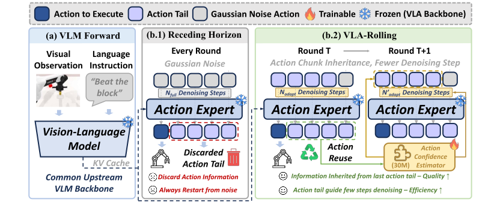
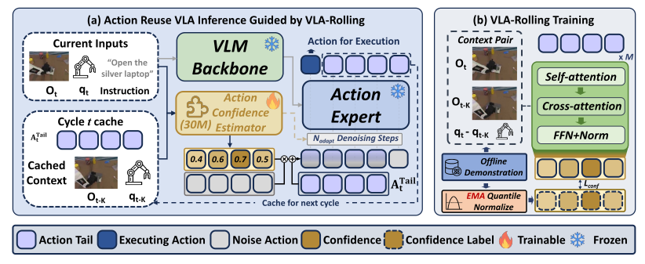

<div align="center">

<h1>VLA-Rolling: Fewer Denoising Steps,<br>Better Control via Adaptive Action Reuse</h1>

<p>Sicheng He, Yi Pan, Qiuting Yu, Jiaming Huang, Qi Lu, Shuyan Wu, Hongyan Feng,<br>
Xuanyu Liu, Jun Zhang, Jie Zhang, Wenqi Zhang, Xuhong Zhang, Jianwei Yin</p>

<p><strong>Zhejiang University</strong><br>OmniAI Group of ZJU ACES Lab</p>

</div>

<p align="center">
  <a href="assets/paper/VLA_Rolling_OmniAI.pdf">[PDF]</a> ·
  <a href="https://chenbao123ww.github.io/VLA-Rolling-site/">[Project Page]</a> ·
  <a href="#installation">[Installation]</a> ·
  <a href="#training">[Training]</a> ·
  <a href="#evaluation-and-inference">[Evaluation and Inference]</a> ·
  <a href="#citation">[Citation]</a>
</p>

## Demo

https://github.com/user-attachments/assets/6b140d35-db40-4aaa-bb9e-0033c23ab3fb

## Overview

**Reuse the action tail. Estimate how much to trust it. Refine with an adaptive denoising budget.**

Action-chunked VLA policies typically execute a short prefix, discard the remaining actions, and start the next prediction from fresh Gaussian noise. VLA-Rolling carries that unexecuted **action tail** into the next planning window. A learned Action Confidence Estimator (ACE) assesses its reuse value under the updated observation, guiding both renoising and the number of denoising steps while keeping the base VLA frozen.



*Figure 1. VLA-Rolling preserves useful denoising progress across successive inference rounds.*

The paper reports **lower action-chunk inference cost in all 16 model–benchmark pairs**, **up to 1.48× speedup**, and **success-rate improvements in 14 pairs**, with a maximum gain of **15.08 percentage points**.

## Abstract

Flow-matching vision-language-action (VLA) models generate an action chunk by iteratively denoising Gaussian noise, but typically execute only a short prefix before replanning with updated observations. Under this receding-horizon paradigm, the unexecuted remainder—the action tail—is discarded, and the next chunk is regenerated from fresh noise. We show that this discarded tail retains transferable denoising progress: action-tail initialization can match or outperform a native 10-step Gaussian baseline using fewer denoising steps. However, the optimal denoising budget varies substantially across samples, indicating that tail reuse should be adapted to the updated environment. Based on this observation, we introduce VLA-Rolling, a lightweight inference framework that reuses action tails through three stages: action-tail inheritance, per-action confidence estimation, and confidence-guided refinement through renoising and denoising budget allocation, while the underlying VLA remains frozen. Across π₀.₅, SmolVLA, X-VLA, and MolmoAct2 on LIBERO, MetaWorld, LIBERO-Plus, and RoboTwin 2.0, VLA-Rolling reduces action-chunk inference cost in all 16 model–benchmark pairs, achieving up to a 1.48× speedup, while improving success rate in 14 pairs by up to 15.08 percentage points. These results show that action tails are not merely discarded predictions, but reusable intermediate states that enable more efficient and accurate VLA inference.

## Method



*Figure 4. The rolling inference loop and offline ACE training procedure from the paper.*

### 1. Action-Tail Inheritance

After executing the first **K** actions of an **H**-step chunk, retain the remaining **L = H − K** actions and align them with the next planning window. Cache the previous observation context so that reuse can be assessed against the new observation.

### 2. Action Confidence Estimation

ACE predicts a confidence score for each inherited action using the **current visual and proprioceptive context and their changes**. It learns from temporally paired demonstrations: inherited actions closer to the aligned demonstrated actions receive higher confidence targets. Only ACE is trained; the underlying VLA remains frozen.

### 3. Confidence-Guided Refinement

- **Confidence-guided renoising:** blend each inherited action with Gaussian noise according to its confidence. Reliable actions retain more of their previous prediction; unreliable actions receive more noise. Newly introduced positions start from Gaussian noise.
- **Adaptive-step denoising:** use the minimum confidence across the inherited tail to allocate a bounded denoising budget. Refine the chunk under the current observation, execute its prefix, and carry its new tail into the next round.

## Result

### Overall Performance

The following results are from **Table 1 of the [paper](assets/paper/VLA_Rolling_OmniAI.pdf)**. Each arrow denotes **baseline → + VLA-Rolling**. Success rate (SR) is averaged across tasks; cost is inference time per action chunk. Δ SR is measured in percentage points (pp), and cost reduction is relative to the baseline.

| Benchmark | Backbone | SR (%) ↑ | Δ SR (pp) | Cost (ms/chunk) ↓ | Cost reduction |
| --- | --- | --- | --- | --- | --- |
| LIBERO | π₀.₅ | 96.38 → **97.83** | +1.45 | 168.09 → **129.60** | 22.90% |
| LIBERO | X-VLA | 96.03 → **96.65** | +0.62 | 135.24 → **112.79** | 16.60% |
| LIBERO | SmolVLA | 73.85 → **79.78** | +5.93 | 127.80 → **89.57** | 29.91% |
| LIBERO | MolmoAct2 | 95.50 → **95.70** | +0.20 | 291.34 → **196.61** | 32.52% |
| MetaWorld | π₀.₅ | 67.22 → **67.88** | +0.66 | 222.69 → **184.21** | 17.28% |
| MetaWorld | X-VLA | 57.08 → **61.46** | +4.38 | 123.31 → **90.05** | 26.97% |
| MetaWorld | SmolVLA | 65.84 → **70.74** | +4.90 | 122.88 → **102.57** | 16.53% |
| MetaWorld | MolmoAct2 | 28.56 → **30.56** | +2.00 | 278.53 → **236.45** | 15.11% |
| LIBERO-Plus | π₀.₅ | 84.73 → **85.42** | +0.69 | 167.65 → **147.40** | 12.08% |
| LIBERO-Plus | X-VLA | 66.04 → 65.91 | -0.13 | 136.80 → **121.93** | 10.87% |
| LIBERO-Plus | SmolVLA | 20.74 → **35.82** | +15.08 | 130.90 → **120.97** | 7.59% |
| LIBERO-Plus | MolmoAct2 | 78.96 → **79.07** | +0.11 | 303.18 → **207.27** | 31.63% |
| RoboTwin 2.0 | π₀.₅ | 66.54 → **67.26** | +0.72 | 172.92 → **164.27** | 5.00% |
| RoboTwin 2.0 | X-VLA | 60.68 → 60.40 | -0.28 | 131.09 → **96.99** | 26.01% |
| RoboTwin 2.0 | SmolVLA | 25.36 → **31.32** | +5.96 | 148.68 → **137.34** | 7.63% |
| RoboTwin 2.0 | MolmoAct2 | 20.18 → **22.34** | +2.16 | 387.06 → **273.95** | 29.22% |

VLA-Rolling reduces inference cost by **5.00–32.52%** across all 16 pairs. Success rate improves in 14 pairs; X-VLA has small decreases on LIBERO-Plus (−0.13 pp) and RoboTwin 2.0 (−0.28 pp).

*Table note: the manuscript prints +9.32 pp for π₀.₅ on MetaWorld, but its displayed success rates are 67.22% and 67.88%. The table above uses their difference, +0.66 pp.*

---

## Installation

### Clone and prepare dependencies

```bash
git clone https://github.com/chenbao123ww/VLA-Rolling.git
cd VLA-Rolling
```

**Before running `uv sync`, follow [src/README.md](src/README.md) to download the pinned LeRobot source and apply the supplied compatibility patch.** Only that guide is tracked under `src/`; dependency source code is downloaded locally. For RoboTwin simulation, also follow the guide to obtain PyTorch3D, RoboTwin, cuRobo, and the simulator assets. Return here after preparing the required sources to install the root uv environment.

### Install the environment

Requirements: Linux x86_64, an NVIDIA GPU with a CUDA 12.8-compatible driver, and system FFmpeg/EGL libraries for video decoding and simulation.

```bash
# Skip if uv is already installed.
python3 -m pip install --user uv==0.13.1
export PATH="$HOME/.local/bin:$PATH"

uv python install 3.12.14
uv sync --locked --extra eval
```

Run all commands from this repository's root. Its `pyproject.toml` and `uv.lock` define the environment, including LeRobot's dependency versions. Use `uv sync --locked` for training without simulator dependencies. Preserve the extras you need when syncing again; the commands below use `uv run --no-sync` to run the installed environment. Add `--extra wandb` when installing if you want W&B logging.

For RoboTwin simulation, first complete the optional source and asset setup in [src/README.md](src/README.md), then install the simulation dependencies and build the native extensions:

```bash
uv sync --locked --extra eval --extra robotwin
uv run --no-sync python scripts/setup_robotwin.py
CUDA_HOME=/usr/local/cuda-12.8 TORCH_CUDA_ARCH_LIST=8.9 \
  bash scripts/install_robotwin_extensions.sh
bash scripts/with_robotwin.sh python -c 'import envs, curobo, pytorch3d'
```

Set `CUDA_HOME` and `TORCH_CUDA_ARCH_LIST` for your installation (`8.9` is for RTX 4090). These extensions are only needed for RoboTwin simulation, not offline ACE training. After building them, use `uv sync --inexact --locked --extra eval --extra robotwin` for subsequent syncs to retain the locally installed extensions.

### Prepare data and checkpoints

Download the benchmark data, a policy checkpoint for the target benchmark, and any tokenizer/VLM assets it requires. Datasets and weights are not included in this repository. Follow [data/README.md](data/README.md) for dataset downloads and RoboTwin data preparation, and [checkpoints/README.md](checkpoints/README.md) for per-model Hugging Face links, download commands, required tokenizer/VLM assets, and checkpoint usage. The examples use:

- `data/libero`, `data/metaworld_mt50`, and `data/robotwin_unified` for benchmark data.
- `checkpoints/main/` for policy checkpoints and tokenizer/VLM assets.
- `checkpoints/ace/` for trained ACE checkpoints.

RoboTwin uses the 14D `robotwin_unified` dataset by default. `X-VLA-RoboTwin2` uses the 20D EE6D dataset at `data/robotwin`. Match the dataset to the policy checkpoint. All training paths can be overridden through command-line arguments.

## Training

Train ACE with the entry point for your benchmark:

| Benchmark | Python module |
| --- | --- |
| LIBERO | `scripts.finetune.libero_ace_finetune` |
| MetaWorld | `scripts.finetune.metaworld_ace_finetune` |
| RoboTwin | `scripts.finetune.robotwin_ace_finetune` |

Example: PI05 on LIBERO using four GPUs and a total batch size of 64.

```bash
CUDA_DEVICE_ORDER=PCI_BUS_ID CUDA_VISIBLE_DEVICES=1,2,3,4 \
uv run --no-sync python -m torch.distributed.run --standalone --nproc_per_node=4 \
  -m scripts.finetune.libero_ace_finetune \
  --model pi05 \
  --model-path checkpoints/main/pi05_libero \
  --tokenizer-path checkpoints/main/vlm_assets/paligemma-3b-pt-224 \
  --dataset-root data/libero \
  --output-dir checkpoints/ace/pi05_libero_H50_K10_L40 \
  --horizon 50 --execute-steps 10 \
  --batch-size 16 --steps 4000 --lr 1e-4 --seed 1 \
  --no-wandb
```

Choose available GPU IDs for your machine. For a single GPU, replace `python -m torch.distributed.run --standalone --nproc_per_node=4` with `python`. Set `--steps 2` and a separate `--output-dir` for an initial smoke run. Long training runs can be launched inside a tmux session.

Training arguments use **`--argument value`**:

| Argument | Usage |
| --- | --- |
| `--model` | `pi05`, `smolvla`, `xvla`, or `molmoact2` |
| `--model-path` | Local policy checkpoint directory |
| `--dataset-root` | Local benchmark dataset directory |
| `--output-dir` | Directory for ACE checkpoints |
| `--batch-size` | Batch size **per GPU/process**; four GPUs × 16 gives 64 |
| `--steps`, `--lr`, `--seed` | Training steps, learning rate, and random seed |
| `--horizon`, `--execute-steps` | Policy chunk length and actions executed per update; horizon must match the policy |
| `--tokenizer-path` | Override a tokenizer path stored in the policy checkpoint |
| `--vlm-model-path` | Override the VLM asset path, e.g. for SmolVLA |
| `--no-wandb` | Disable W&B logging |

Switch the module, model, checkpoint, dataset, and output paths to train another combination. The result is saved as `<output-dir>/checkpoint_last/model.pt`. See all supported arguments with:

```bash
uv run --no-sync python -m scripts.finetune.libero_ace_finetune --help
```

LIBERO-Plus is evaluation-only and reuses the corresponding LIBERO policy and ACE checkpoint.

## Evaluation and Inference

### Simulator rollouts

The current ACE rollout wrappers support **PI05**. Prepare its policy checkpoint, trained ACE checkpoint, and the benchmark's simulator assets before running:

```bash
MUJOCO_GL=egl CUDA_VISIBLE_DEVICES=0 uv run --no-sync python \
  -m scripts.inference.libero_ace_rollout \
  --policy.path=checkpoints/main/pi05_libero \
  --ace.checkpoint=checkpoints/ace/pi05_libero_H50_K10_L40/checkpoint_last/model.pt \
  --ace.execute_steps=10 \
  --env.task=libero_spatial \
  --env.task_ids='[0]' \
  --eval.n_episodes=5 \
  --output_dir=eval_logs/pi05_libero
```

Rollout arguments use **`--group.argument=value`** and override the wrapper defaults. Use `--policy.path` and `--ace.checkpoint` to select weights, `--env.task` to select the task/suite, `--eval.n_episodes` to set the evaluation length, and `--output_dir` to choose the result directory. `--ace.execute_steps` must match the ACE checkpoint's training configuration.

| Benchmark | Python module | Task example |
| --- | --- | --- |
| LIBERO | `scripts.inference.libero_ace_rollout` | `--env.task=libero_spatial --env.task_ids='[0]'` |
| MetaWorld | `scripts.inference.metaworld_ace_rollout` | `--env.task=assembly-v3` |
| LIBERO-Plus | `scripts.inference.libero_plus_ace_rollout` | `--env.task=libero_spatial --env.task_ids='[0]'` |

Select the matching policy and ACE checkpoint when switching benchmarks. For LIBERO-Plus, use LIBERO weights and install the additional benchmark assets as described in [src/README.md](src/README.md).

## Citation

If you use VLA-Rolling in your research, please cite our paper. Publication details will be added here.

```bibtex
@misc{vlarolling,
  title  = {TODO: Paper title},
  author = {TODO: Authors},
  year   = {TODO: Year},
  url    = {TODO: Paper URL}
}
```
